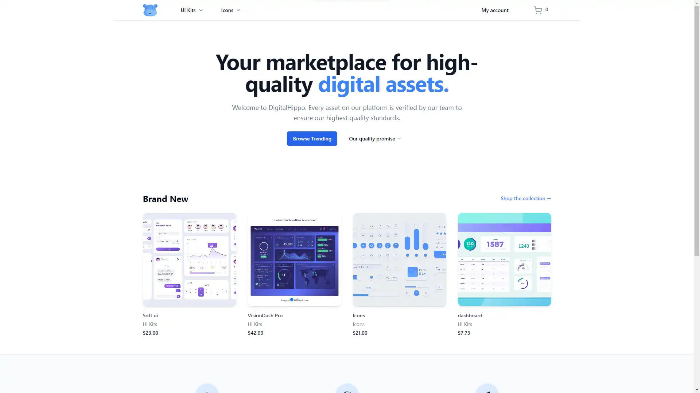

<h1> Digital Marketplace </h1>

Your marketplace for digital assets.



### 🌐 Website: <https://www.digital.marketplace.abielrodriguez.dev>

## Features 💡

- Users can sign up (with email verification) and log in securely.
- Secure payments with Stripe Checkout.
- Sellers list products through an admin panel (`/sell`) where they can create, read, update and delete them.
- Admins review products before they go on sale.
- Buyers download their files after paying.
- Responsive design for all screen sizes.

## Built with ⚒️

- [Next.js](https://nextjs.org/) 16 + [React](https://react.dev/) 19 - The React framework for the web.
- [TypeScript](https://www.typescriptlang.org/) - A strongly typed language that builds on JavaScript.
- [Payload CMS](https://payloadcms.com/) 3 - Headless CMS and admin panel, running inside the Next.js app.
- [tRPC](https://trpc.io/) - Fully typesafe APIs.
- [MongoDB Atlas](https://www.mongodb.com/atlas/database) - Cloud database.
- [Stripe](https://stripe.com/) - Payments (test mode).
- [Tailwind CSS](https://tailwindcss.com/) + [shadcn/ui](https://ui.shadcn.com/) - Styling and components.
- [Vercel](https://vercel.com/) + Vercel Blob - Hosting and file storage.
- [Playwright](https://playwright.dev/) - API and end-to-end tests.

## Getting started

1. Clone the repository and install dependencies (uses [pnpm](https://pnpm.io/)):

   ```sh
   git clone https://github.com/arr199/digital-marketplace
   cd digital-marketplace
   pnpm install
   ```

2. Create a `.env` file in the project root:

   ```sh
   PAYLOAD_SECRET=...
   MONGODB_URL=...
   NEXT_PUBLIC_SERVER_URL=http://localhost:3000
   GMAIL_SERVER_USER=...
   GMAIL_SERVER_PASS=...          # Gmail app password
   STRIPE_SECRET_KEY=...
   STRIPE_WEBHOOK_SECRET=...
   ```

3. Run the dev server:

   ```sh
   pnpm dev
   ```

   The store is at <http://localhost:3000> and the admin panel at <http://localhost:3000/sell>.
   Locally, uploads are stored on disk (`src/server/media`, `src/server/products_files`).

## Tests 🧪

The tests run against a production build with local stand-ins for MongoDB, Stripe and email (needs Docker):

```sh
pnpm test:services   # start the test containers
pnpm test            # run all tests
```

See [tests/README.md](tests/README.md) for details. CI runs the same tests on every pull request into `master`.

## Deployment 🚀

The app is deployed on Vercel from the `master` branch. See [docs/deploy-vercel.md](docs/deploy-vercel.md).
